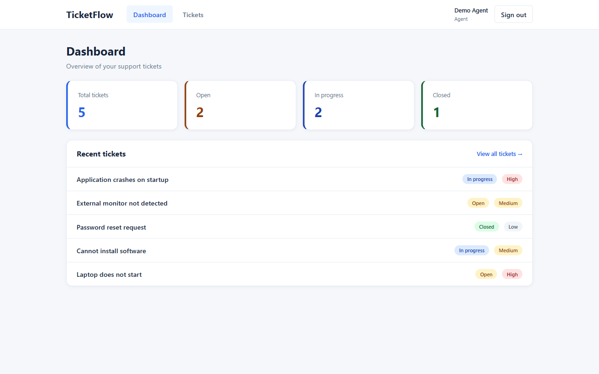
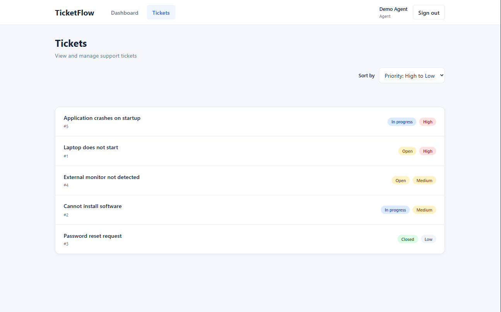
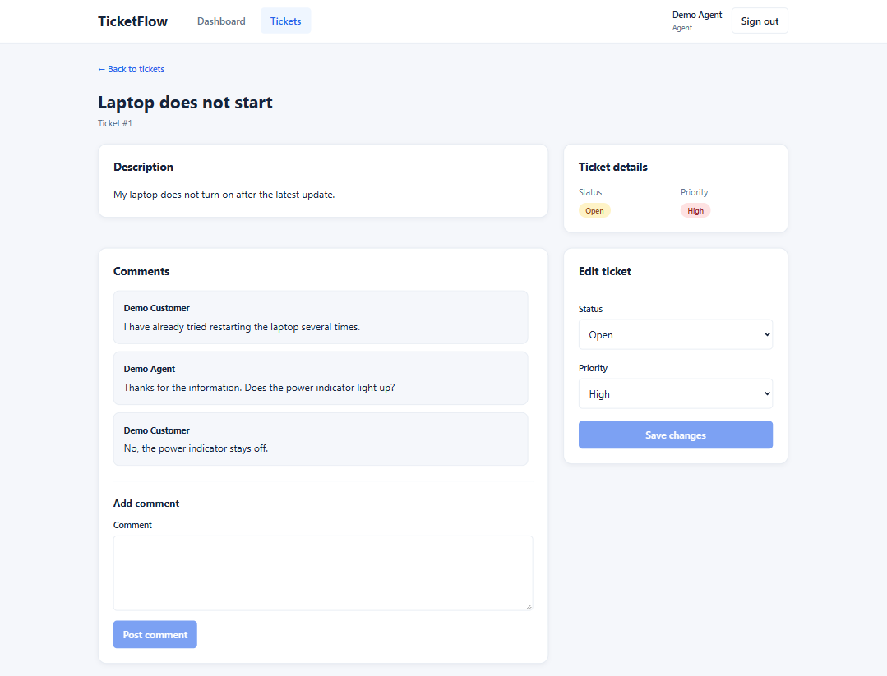

# TicketFlow

A full-stack helpdesk ticket management application built with React, TypeScript, Laravel, and PostgreSQL.

TicketFlow provides a role-based ticket management workflow for customers and support staff. It was developed as a portfolio project with a focus on maintainable code, REST API design, authentication, authorization, automated testing, and containerized development.

**Project status:** MVP implemented and tested. Public deployment is in preparation.

## Über das Projekt

TicketFlow ist ein eigenständig entwickeltes Full-Stack-Portfolio-Projekt für Bewerbungen im Bereich Anwendungsentwicklung und Softwareentwicklung.

Die Anwendung bildet ein Helpdesk-Ticketsystem ab, in dem Kunden Support-Tickets erstellen und verfolgen können. Support-Mitarbeiter verwalten Tickets, bearbeiten deren Status und Priorität und kommunizieren über Kommentare.

Technische Schwerpunkte sind die Entwicklung einer REST-API mit Laravel, ein React-Frontend mit TypeScript, rollenbasierte Zugriffskontrolle, automatisierte Tests sowie eine containerisierte Entwicklungsumgebung mit Docker.

*Die technische Dokumentation ist auf Englisch verfasst.*

## Screenshots

### Dashboard



### Ticket Overview



### Ticket Details



## Features

### Authentication and Authorization

TicketFlow uses Laravel Sanctum with session-based authentication for its React frontend.

- Users authenticate with their email address and password.
- Laravel manages authentication using session cookies.
- CSRF protection is used for state-changing requests.
- Protected API endpoints use the `auth:sanctum` middleware.
- Laravel Gates and Policies enforce role-based authorization.

Customers can only access their own tickets, while support agents and administrators can manage tickets across customers.

Authentication and authorization are enforced by the backend rather than relying solely on frontend restrictions.

### Ticket Management

- Create and view support tickets
- Assign tickets to categories
- Track ticket status and priority
- Update ticket status and priority (Support Agent and Admin)
- Reopen closed tickets
- Add comments to tickets
- Sort tickets by creation date or priority

### Dashboard

- Ticket statistics
- Recent tickets
- Role-specific ticket visibility

### Demo Data

- Preconfigured demo accounts for all three roles
- Two separate customer accounts
- Sample tickets with different statuses, priorities, and categories
- Sample ticket comments

## Tech Stack

| Area | Technologies |
|---|---|
| Frontend | React, TypeScript, Vite, CSS Modules |
| Backend | PHP 8.4, Laravel 13, REST API |
| Database | PostgreSQL 17 |
| Development | Docker, Docker Compose |
| Testing and Quality | Laravel Feature Tests, PHPUnit, Laravel Pint, ESLint |
| CI | GitHub Actions |
| Version Control | Git, GitHub |

## Architecture

TicketFlow uses a separate frontend and backend.

```text
React + TypeScript
        |
        | HTTP / REST API
        v
Laravel (PHP)
        |
        | Eloquent ORM
        v
PostgreSQL
```

The frontend handles user interaction, navigation, and presentation.

The Laravel backend provides authentication, authorization, validation, and ticket management through a REST API.

PostgreSQL stores users, tickets, categories, and comments.

Authorization is enforced on the backend. Customers can access only their own tickets, while support agents and administrators can access tickets across customers.

### Docker Development Environment

The local development environment uses Docker Compose with three services:

- **Frontend:** Node.js 24 running the Vite development server
- **Backend:** PHP 8.4 running Laravel's development server
- **Database:** PostgreSQL 17 with persistent Docker storage

The frontend and backend source directories are mounted into their containers, allowing changes to be reflected during development without rebuilding the images.

The backend image includes Composer and Xdebug for local development.

Application ports are bound to `127.0.0.1` on the host.

The `compose.override.yaml` file exposes PostgreSQL on `127.0.0.1:5432` for local database tools. This port is not required for communication between the application containers.

The database port must be available on the host when using the default Compose configuration.

The current Docker configuration is intended for development and is not a production deployment configuration.

## Getting Started

### Prerequisites

- Docker with Docker Compose
- Git

### 1. Clone the repository

```bash
git clone https://github.com/ReneFeige/TicketFlow
cd TicketFlow
```

### 2. Configure environment variables

Create the Docker Compose environment file:

```bash
cp .env.example .env
```

Create the Laravel environment file:

```bash
cp backend/.env.example backend/.env
```

Both environment files must use the same PostgreSQL database name, username, and password.

In the root `.env` file:

```dotenv
DB_DATABASE=ticketflow
DB_USERNAME=ticketflow
DB_PASSWORD=your_local_password
```

In `backend/.env`:

```dotenv
DB_CONNECTION=pgsql
DB_HOST=db
DB_PORT=5432
DB_DATABASE=ticketflow
DB_USERNAME=ticketflow
DB_PASSWORD=your_local_password

FRONTEND_URL=http://localhost:5173
SANCTUM_STATEFUL_DOMAINS=localhost:5173,localhost:8000
```

The hostname `db` refers to the PostgreSQL service defined in Docker Compose.

**Security:** Environment files may contain credentials and must not be committed to Git.

### 3. Start the database

```bash
docker compose up -d db
```

### 4. Install backend dependencies

```bash
docker compose run --rm backend composer install
```

Generate the Laravel application key:

```bash
docker compose run --rm backend php artisan key:generate
```

### 5. Install frontend dependencies

```bash
docker compose run --rm \
  -e npm_config_cache=/tmp/.npm \
  frontend npm ci
```

### 6. Start the application

```bash
docker compose up -d
```

### 7. Run database migrations and seeders

```bash
docker compose exec backend php artisan migrate --seed
```

This initializes the database and creates demo users, tickets, categories, and comments.

## Demo Accounts

The local demo includes the following accounts:

| Role | Email |
|---|---|
| Customer | customer@ticketflow.demo |
| Customer | customer2@ticketflow.demo |
| Support Agent | agent@ticketflow.demo |
| Admin | admin@ticketflow.demo |

**Demo password:** `Demo1234!`

These credentials are intended exclusively for the demonstration environment. All demo data is fictional.

The login page also provides buttons for signing in with demo accounts.

## Local URLs

| Service | URL |
|---|---|
| React frontend | http://localhost:5173 |
| Laravel backend | http://localhost:8000 |
| API health endpoint | http://localhost:8000/api/health |

The development servers are exposed on the host's loopback interface.

The frontend uses a Vite development proxy to forward API requests to the Laravel backend.

## Development

Stop the application:

```bash
docker compose down
```

Check running containers:

```bash
docker compose ps
```

View backend logs:

```bash
docker compose logs -f backend
```

## Testing and Code Quality

### Backend Tests

Backend tests use a dedicated PostgreSQL database (`ticketflow_test`) to keep test data separate from development data.

Create the test database once:

```bash
docker compose exec db psql -U ticketflow -d ticketflow -c "CREATE DATABASE ticketflow_test;"
```

Run migrations for the test database:

```bash
docker compose exec \
  -e APP_ENV=testing \
  -e DB_CONNECTION=pgsql \
  -e DB_DATABASE=ticketflow_test \
  backend php artisan migrate --force
```

Run the backend test suite:

```bash
docker compose exec backend php artisan test
```

The PHPUnit configuration in `backend/phpunit.xml` uses the dedicated test database.

**Never run tests against the development or production database.**

### Laravel Pint

Check PHP code formatting:

```bash
docker compose exec backend ./vendor/bin/pint --test
```

Automatically format PHP code:

```bash
docker compose exec backend ./vendor/bin/pint
```

### Frontend Linting

```bash
docker compose exec frontend npm run lint
```

### Frontend Production Build

```bash
docker compose exec frontend npm run build
```

## Continuous Integration

GitHub Actions automatically runs quality checks for pull requests targeting the `main` branch.

The CI workflow consists of two independent jobs:

**Frontend**
- Install dependencies using `npm ci` with Node.js 24
- Run ESLint
- Create a production build using Vite

**Backend**
- Install Composer dependencies using PHP 8.4
- Start a PostgreSQL 17 service
- Prepare the Laravel testing environment
- Run database migrations
- Execute automated Laravel tests
- Check PHP code formatting with Laravel Pint

The backend tests run against a dedicated PostgreSQL test database to prevent modifications to development or production data.

The workflow provides automated validation before merging changes into `main`. Deployment is not currently automated.

## Roadmap

Potential future improvements include:

- File attachments
- Notifications
- Knowledge base
- Advanced search and filtering
- AI-assisted ticket classification
- AI-generated ticket summaries and response suggestions

These features are not part of the initial MVP.

## Project Purpose

TicketFlow was developed as a portfolio project to demonstrate practical full-stack development skills.

The project emphasizes:

- Clear separation of frontend and backend responsibilities
- Secure authentication and role-based authorization
- Database modeling and API development
- Automated testing and code quality
- Containerized development and reproducible setup
- Version control and CI workflows

The goal is to deliver a functional, understandable, and maintainable application rather than maximize the number of features.